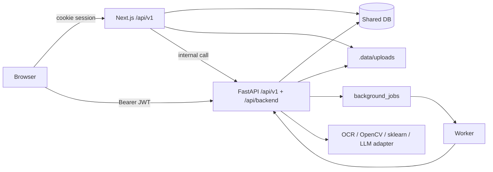

# TrustDrive — Current Architecture (as built)

> Two runtimes, one relational database, no removed feature. This is the actual
> state after the completion pass, not a target diagram.

## 1. Components

| Component | Runtime | Port | Responsibility |
| --- | --- | --- | --- |
| Web app | Next.js 14 (Node 22) | 3000 | Public site, Seller/Buyer portals, cookie-session REST (`/api/v1/*`), PDF/QR, DB owner |
| Backend API | FastAPI (Python 3.12+) | 8000 | `/api/v1/*` contract + `/api/backend/*` internal surface, bearer JWT |
| Intelligence | FastAPI (same process) | 8000 | OCR pipeline, fraud detectors, 15/16-node conditional agent, trust score |
| Worker | Python (`app.worker`) | — | DB-backed `background_jobs` queue; Celery when `TD_BROKER_URL` is set |
| Database | SQLite file (Postgres target) | — | 51 tables shared by both runtimes |
| Storage | `.data/uploads` (S3 target) | — | Private documents, report PDFs |

## 2. Request flow

- End users authenticate against **one** `users` table. Both runtimes verify the
  same scrypt hash and accept the same HS256 token (`app/security.py`).
- The web app owns the schema. The Python service reflects it with SQLAlchemy
  and writes only columns that exist.
- Slow work (OCR, reports, agent) is enqueued in `background_jobs`; a dashboard
  request never blocks on it.

## 3. Directory ownership

| Responsibility | Web (Next.js) | Python |
| --- | --- | --- |
| Route registration | `app/api/v1/*/route.ts` | `app/routers/v1.py`, `routers/*.py` |
| Auth / permissions | `lib/server/auth.ts`, `http.ts` | `app/security.py`, `app/routers/auth.py` |
| Domain data access | `lib/server/data.ts` | `app/repository.py`, `app/db.py` |
| Validation | Zod (`lib/server/validate.ts`) | Pydantic v2 (`routers/*.py`) |
| OCR / extraction | — | `app/ocr.py`, `app/extract.py` |
| Fraud / ML | deterministic `engine.ts` | `app/detectors.py`, `app/explain.py` |
| Agent | grounded assistant `lib/server/ai.ts` | `app/agent.py` (15/16 conditional nodes) |
| Reports / PDF | `app/api/v1/reports/*` | `app/routers/reports.py` (PyMuPDF) |
| Jobs | — | `app/worker.py`, `app/tasks.py` |
| Migrations | seed in `lib/server/db.ts` | `alembic/` (additive) |

The checklist's proposed `backend/app/{api,core,db,models,schemas,repositories,
services,storage,integrations,processing,intelligence,agents,reports,blockchain,
notifications,tasks,utils}` tree maps onto this repository as:

- `api` → `app/routers/` (v1 + backend + intelligence)
- `core` → `app/{config,security,ratelimit,logging}.py`
- `db` → `app/db.py` (reflection) + the Next.js schema owner
- `repositories` → `app/repository.py`
- `services` → router functions + `app/{extract,detectors,explain,agent}.py`
- `processing` → `app/{ocr,extract}.py`
- `intelligence` → `app/{detectors,explain}.py`
- `agents` → `app/agent.py`
- `reports` → `app/routers/reports.py`
- `notifications` → `app/routers/notifications.py`
- `tasks` → `app/{worker,tasks}.py`
- `blockchain` → `chain_records` table + `GET /api/intelligence/integrity/{id}`
- `storage` → `settings.upload_dir` (S3 adapter slot via `TD_S3_*`)

A separate `models/` package is intentionally absent: the schema is owned by the
Next.js seed, and the Python side reflects it. Declaring a second set of models
would create a drift risk with no benefit.

## 4. Environments

| Env | DB | Broker | Storage |
| --- | --- | --- | --- |
| local | SQLite `.data/trustdrive.db` | DB-backed worker | `.data/uploads` |
| docker | SQLite volume (default) or Postgres (`production` profile) | worker or Celery | volume |
| production target | PostgreSQL (`TD_DB_URL`) | Redis/Celery (`TD_BROKER_URL`) | S3/MinIO (`TD_S3_*`) |

See `docs/DEPLOYMENT.md` for commands and `docs/SYSTEM_ARCHITECTURE.md` for the
deployment view.
