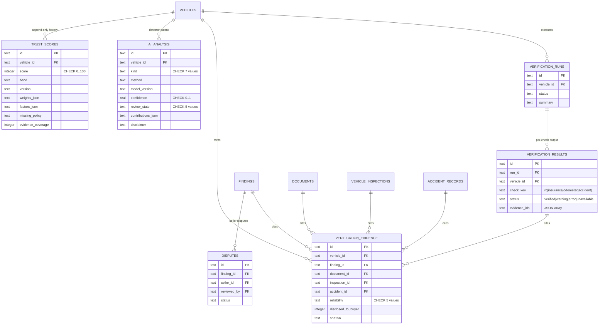
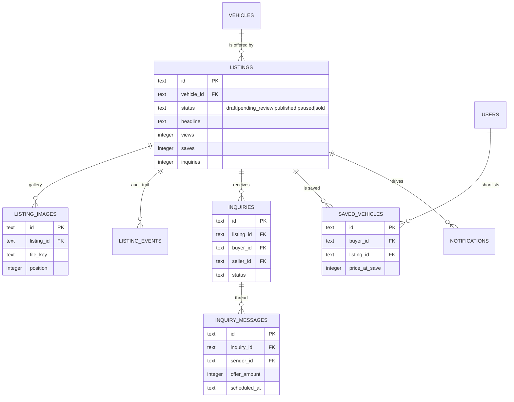
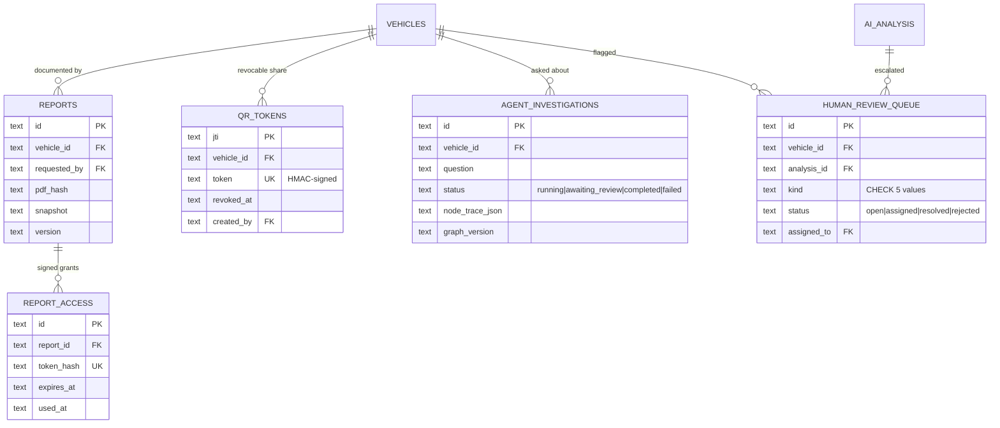

# TrustDrive — Entity Relationship Diagram

One shared relational database serves both portals and both runtimes. This
document is generated against the live schema (51 tables, 30 explicit indexes,
11 immutability triggers, 5 canonical entity views) — not against an intended
schema. Re-derive it with `npm run schema:dump`.

Naming: five entities keep a historical table name and expose the briefed name
as a view, so both spellings are real relations over the same rows:

| Briefed name       | Physical table   | Access |
| ------------------ | ---------------- | ------ |
| `vehicle_documents`| `documents`      | view over table |
| `vehicle_listings` | `listings`       | view over table |
| `vehicle_history`  | `history_events` | view over table |
| `mileage_records`  | `mileage_readings` | view over table |
| `blockchain_records` | `chain_records` | view over table |

---

## 1. Required entities → implementation

All 24 entities named in the architecture brief exist, with foreign keys.

| # | Required entity    | Table (or view)          | Rows in dev seed | Purpose |
| - | ------------------ | ------------------------ | ---------------- | ------- |
| 1 | users              | `users`                  | 7 | Identity for buyer/seller/admin |
| 2 | seller_profiles    | `seller_profiles`        | 1 | KYC, GSTIN/PAN, dealer badge |
| 3 | buyer_profiles     | `buyer_profiles`         | 1 | Budget, city, preferences |
| 4 | vehicles           | `vehicles`               | 13 | Vehicle of record (TrustDrive ID, VIN, reg) |
| 5 | vehicle_documents  | `documents` (+ view)     | 80 | Private uploads, SHA-256, extraction JSON |
| 6 | vehicle_images     | `vehicle_images`         | 5 | Buyer-visible gallery, soft-deletable |
| 7 | vehicle_listings   | `listings` (+ view)      | 13 | Marketplace offering per vehicle |
| 8 | vehicle_history    | `history_events` (+ view)| 25 | Service / ownership / incident timeline |
| 9 | mileage_records    | `mileage_readings` (+ view) | 35 | Yearly odometer readings with source |
| 10 | accident_records  | `accident_records`       | 5 | Reported accidents, severity CHECK, repair state |
| 11 | damage_records    | `damage_records`         | 8 | Zone-level damage with photo keys |
| 12 | vehicle_inspections | `vehicle_inspections`  | 5 | Third-party inspection + review state |
| 13 | verification_results | `verification_results` | 0 | Per-check outcome of a run (written by verify API) |
| 14 | verification_evidence | `verification_evidence` | 5 | Immutable pointer to the source of a claim |
| 15 | ai_analysis       | `ai_analysis`            | 5 | Detector output: method, model version, confidence |
| 16 | trust_scores      | `trust_scores`           | 5 | Append-only scored history per vehicle |
| 17 | inquiries         | `inquiries`              | 5 | Buyer↔seller conversation header |
| 18 | inquiry_messages  | `inquiry_messages`       | 6 | Messages, offers, scheduled visits |
| 19 | saved_vehicles    | `saved_vehicles`         | 3 | Buyer shortlist + price at save |
| 20 | reports           | `reports`                | 8 | Generated PDF report artefacts |
| 21 | blockchain_records | `chain_records` (+ view) | 111 | SHA-256 hash chain per vehicle |
| 22 | audit_logs        | `audit_logs`             | 5 | Actor, entity, before/after, IP |
| 23 | notifications     | `notifications`          | 10 | In-app user notifications |
| 24 | background_jobs   | `background_jobs`        | 10 | Durable job queue for slow AI work |

Supporting entities added by the implementation (not in the brief's list, each
needed by a shipped feature): `verification_runs`, `findings`, `disputes`,
`pricing`, `listing_images`, `listing_events`, `qr_tokens`, `report_access`,
`auth_tokens`, `sessions`, `login_attempts`, `saved_searches`, `activity`,
`theft_checks`, `contact_messages`, `newsletter_subscribers`,
`agent_investigations`, `human_review_queue`.

---

## 2. Identity and profiles

```mermaid
erDiagram
  USERS ||--o| SELLER_PROFILES : "1:1 seller extension"
  USERS ||--o| BUYER_PROFILES : "1:1 buyer extension"
  USERS ||--o{ VEHICLES : "owns"
  USERS ||--o{ SESSIONS : "signs in"
  USERS ||--o{ AUTH_TOKENS : "resets / verifies"
  USERS ||--o{ NOTIFICATIONS : "receives"
  USERS ||--o{ ACTIVITY : "tracks"
  USERS ||--o{ SAVED_VEHICLES : "shortlists"
  USERS ||--o{ SAVED_SEARCHES : "saves"
  USERS ||--o{ AUDIT_LOGS : "acts"

  USERS {
    text id PK
    text name
    text role "buyer|seller|admin"
    text email UK
    text password_hash "scrypt"
    text kyc_status
    integer twofa_enabled
  }
  SELLER_PROFILES {
    text user_id PK_FK
    text business_name
    text gstin
    text pan
    integer verified_dealer
    text trust_badge
    text deleted_at "soft delete"
  }
  BUYER_PROFILES {
    text user_id PK_FK
    integer budget_min
    integer budget_max
    text preferred_makes "JSON array"
    text deleted_at "soft delete"
  }
  SESSIONS {
    text id PK
    text user_id FK
    text refresh_hash UK
    text revoked_at
  }
```

`seller_profiles` / `buyer_profiles` are `ON DELETE CASCADE` extensions keyed by
`user_id`, so a profile row can never outlive its user. Personal documents are
never stored here — KYC files live in `documents` and are consent-gated.

---

## 3. Vehicle of record and its facts

```mermaid
erDiagram
  VEHICLES ||--o{ DOCUMENTS : "evidence uploads"
  VEHICLES ||--o{ VEHICLE_IMAGES : "gallery"
  VEHICLES ||--o{ MILEAGE_READINGS : "odometer history"
  VEHICLES ||--o{ HISTORY_EVENTS : "timeline"
  VEHICLES ||--o{ ACCIDENT_RECORDS : "reported accidents"
  VEHICLES ||--o{ DAMAGE_RECORDS : "damage zones"
  VEHICLES ||--o{ VEHICLE_INSPECTIONS : "inspections"
  VEHICLES ||--o{ FINDINGS : "rule output"
  VEHICLES ||--o{ CHAIN_RECORDS : "hash chain"
  VEHICLES ||--o{ QR_TOKENS : "shareable tokens"
  VEHICLES ||--o{ THEFT_CHECKS : "stolen-vehicle checks"
  VEHICLES ||--o| PRICING : "market value"

  VEHICLES {
    text id PK
    text owner_id FK
    text trustdrive_id UK
    text vin UK
    text reg_no UK
    integer km_claimed
    integer last_verified_km
    integer asking_price
    text status
  }
  DOCUMENTS {
    text id PK
    text vehicle_id FK
    text type "rc|insurance|service|puc|invoice|kyc"
    text sha256 "content hash"
    text status "pending|verified|rejected"
    integer consent
    integer version
    text supersedes_id FK_SELF
    text extracted "JSON"
  }
  MILEAGE_READINGS {
    text id PK
    text vehicle_id FK
    text document_id FK
    integer km
    integer verified
    integer is_seller_claim
    integer flagged
  }
  HISTORY_EVENTS {
    text id PK
    text vehicle_id FK
    text evidence_document_id FK
    text category
    integer mileage_km
    text status "verified rows are immutable"
  }
  ACCIDENT_RECORDS {
    text id PK
    text vehicle_id FK
    text event_date
    text severity "CHECK 5 values"
    text repair_status "CHECK 6 values"
    text damage_zones "JSON"
    text repair_invoice_doc_id FK
    integer verified
    text deleted_at
  }
  DAMAGE_RECORDS {
    text id PK
    text vehicle_id FK
    text zone_id
    text severity
    text repair_invoice_doc_id FK
    text supersedes_id
  }
  VEHICLE_INSPECTIONS {
    text id PK
    text vehicle_id FK
    text inspector_id FK
    text inspection_type
    integer odometer_km
    integer structural_damage "CHECK 0|1"
    integer passed "CHECK 0|1"
    text status "pending|approved|rejected|superseded"
    text reviewed_by FK
  }
```

Supersession, not mutation: `documents.supersedes_id`,
`damage_records.supersedes_id`, `history_events.supersedes_id` and
`vehicle_inspections.status = 'superseded'` express corrections as new rows so a
verified record is never silently rewritten (enforced by triggers, §7).

---

## 4. Verification engine, evidence and trust



`verification_evidence` is the single join point between a claim and its source:
a buyer-visible statement always resolves to a document, inspection, accident or
finding row, so UI text can be traced to evidence instead of asserted.

---

## 5. Marketplace



---

## 6. Reports, QR sharing and integrity



`chain_records` is a per-vehicle hash chain (`seq`, `prev_hash`, `record_hash`).
It stores hashes and references only — no personal data and no original
documents — and is protected by `chain_no_update` / `chain_no_delete`.

---

## 7. Constraints, indexes, immutability

**CHECK constraints** (SQLite-enforced, not app-only):
`accident_records.severity` · `accident_records.repair_status` ·
`vehicle_inspections.structural_damage` · `vehicle_inspections.passed` ·
`vehicle_inspections.status` · `verification_evidence.reliability` ·
`ai_analysis.kind` · `ai_analysis.severity` · `ai_analysis.confidence BETWEEN 0 AND 1` ·
`ai_analysis.review_state` · `trust_scores.score BETWEEN 0 AND 100` ·
`background_jobs.status` · `agent_investigations.status` ·
`human_review_queue.kind` · `human_review_queue.status`

**Uniques**: `users.email`, `vehicles.reg_no`, `vehicles.vin`,
`login_attempts.key`, `newsletter_subscribers.email`, the two PK-as-FK profile
keys, `pricing.vehicle_id`, `theft_checks.vehicle_id`, `activity.user_id`,
`saved_vehicles(buyer_id, listing_id)` — a buyer cannot double-save a listing —
`chain_records(vehicle_id, seq)` — a hash chain cannot fork — and
`background_jobs.idempotency_key`. Token lookups (`auth_tokens.token_hash`,
`report_access.token_hash`) use non-unique indexes because a hash is only
compared, never inserted twice by design; `documents.sha256` is deliberately
*not* unique — duplicate detection is a reported signal (`getDuplicateDocumentCount`),
not a write blocker, so a seller can legitimately re-upload the same RC.

**Immutability triggers** — verified history cannot be rewritten or removed:

| Trigger | Table | Blocks |
| ------- | ----- | ------ |
| `documents_verified_immutable` | `documents` | UPDATE of a `verified` row |
| `documents_verified_no_delete` | `documents` | DELETE of a `verified` row |
| `history_verified_immutable` | `history_events` | UPDATE of a `verified` row |
| `history_verified_no_delete` | `history_events` | DELETE of a `verified` row |
| `damage_verified_no_delete` | `damage_records` | DELETE of verified damage |
| `trg_trust_scores_immutable` / `_nodelete` | `trust_scores` | UPDATE / DELETE |
| `trg_evidence_immutable` | `verification_evidence` | UPDATE |
| `trg_ai_analysis_nodelete` | `ai_analysis` | DELETE |
| `chain_no_update` / `chain_no_delete` | `chain_records` | UPDATE / DELETE |

**Indexes** (30) cover the read paths the dashboards actually perform —
`idx_vehicles_owner|reg|vin`, `idx_docs_vehicle`, `idx_mileage_vehicle`,
`idx_history_vehicle`, `idx_findings_vehicle`, `idx_listings_status`,
`idx_inquiries_buyer|seller`, `idx_notifications_user`, `idx_sessions_user`,
`idx_report_access_hash`, `idx_auth_tokens_hash`, `idx_contact_created`,
`idx_jobs_claim(status,priority,run_after)`, `idx_trust_vehicle`, `idx_ai_vehicle`,
`idx_ai_review`, `idx_evidence_vehicle`, `idx_evidence_result`,
`idx_inspections_vehicle|status`, `idx_accident_vehicle|severity`,
`idx_vimages_vehicle`, `idx_invest_vehicle`, `idx_review_status`,
`idx_seller_profiles_city`.

---

## 8. Data-lifecycle rules implemented

- **Transactions** — `transact()` in `lib/server/db-intelligence.ts` wraps
  `BEGIN IMMEDIATE` / `COMMIT` / `ROLLBACK` and is re-entrant, so a multi-table
  write (record + evidence + audit) commits atomically. Covered by a rollback test.
- **Soft deletion** — `deleted_at` on `seller_profiles`, `buyer_profiles`,
  `vehicle_images`, `accident_records`, `vehicle_inspections`; every reader in
  `db-intelligence.ts` filters `deleted_at IS NULL`. Verified-history tables are
  not soft-deletable because their rows are append-only.
- **Pagination** — `getAuditPage(limit, offset)` + `countAuditLogs()` for admin
  audit; list endpoints accept `limit`/`offset` and return a `page` envelope.
- **Idempotent job queue** — `background_jobs.idempotency_key` is UNIQUE, so a
  retried enqueue returns the existing job; `claim()` locks a row, exponential
  backoff moves it `failed → queued → dead`.

## 9. Migration path

The Next.js runtime owns this schema and upgrades it in place
(`SCHEMA_VERSION`, `ensurePublicTables`, `ensureIntelligenceTables`,
`upgradeCoreForeignKeys` in `lib/server/schema-fk.ts`, which snapshots
`.data/pre-fk-<stamp>.db` before the first rebuild and reports
`PRAGMA foreign_key_check` afterwards).
The Python service expresses the same schema as SQLAlchemy models and adds
Alembic revisions that start from that baseline (`services/intelligence/alembic/`)
so both runtimes stay on one database. Until that service is created (tracked in
[IMPLEMENTATION_STATUS.md](../IMPLEMENTATION_STATUS.md)), the Next.js runtime is
the sole owner of the schema and the Alembic line is the open Phase 4 item.
