# TrustDrive — ER Diagram

> Generated against the **live schema**, not an intended one. Re-derive with
> `npm run schema:dump` (writes `docs/ERD.md`). This file is the index and the
> relationship view; `docs/ERD.md` holds the full column-level detail.

**Live schema:** 51 tables · 30 explicit indexes · 11 immutability triggers ·
5 canonical entity views · `SCHEMA_VERSION = 3` (`PRAGMA user_version = 3`).
One SQLite file (`.data/trustdrive.db`) is shared by the Next.js runtime
(`node:sqlite`) and the Python runtime (SQLAlchemy 2.x). Postgres is the
documented production target, selected by `TD_DB_URL`.

## Canonical naming

Five briefed entity names are exposed as **views over historical tables**, so
both spellings are real relations over the same rows:

| Briefed name | Physical table | View |
| --- | --- | --- |
| `vehicle_documents` | `documents` | `vehicle_documents` |
| `vehicle_listings` | `listings` | `vehicle_listings` |
| `vehicle_history` | `history_events` | `vehicle_history` |
| `mileage_records` | `mileage_readings` | `mileage_records` |
| `blockchain_records` | `chain_records` | `blockchain_records` |

## Entity relationship diagram (Mermaid)

```mermaid
erDiagram
    users ||--o| seller_profiles : "has"
    users ||--o| buyer_profiles  : "has"
    users ||--o{ sessions        : "opens"
    users ||--o{ notifications   : "receives"
    users ||--o{ audit_logs      : "acts"

    users ||--o{ vehicles        : "owns (seller)"
    vehicles ||--|| listings     : "offered as"
    vehicles ||--o{ documents    : "RC / insurance / PUC / invoices"
    vehicles ||--o{ vehicle_images : "gallery"
    vehicles ||--o{ listing_images : "listing gallery"
    vehicles ||--o{ history_events : "registration / ownership / service"
    vehicles ||--o{ mileage_readings : "odometer"
    vehicles ||--o{ accident_records : "accidents"
    vehicles ||--o{ damage_records : "zone damage + hotspots"
    vehicles ||--o{ vehicle_inspections : "third-party inspection"
    vehicles ||--o{ theft_checks : "external checks"
    vehicles ||--o{ pricing : "price estimate"

    vehicles ||--o{ verification_runs : "runs"
    verification_runs ||--o{ verification_results : "per-check outcome"
    verification_results ||--o{ verification_evidence : "immutable pointers"
    vehicles ||--o{ findings : "fraud findings"
    findings ||--o{ disputes : "seller dispute"
    vehicles ||--o{ trust_scores : "versioned score"
    vehicles ||--o{ ai_analysis : "analysis payloads"
    vehicles ||--o{ agent_investigations : "15/16-node conditional investigations"
    vehicles ||--o{ reports : "PDF"
    vehicles ||--o{ qr_tokens : "public verification"
    reports  ||--o{ report_access : "consent"

    vehicles ||--o{ chain_records : "SHA-256 immutable chain"
    vehicles ||--o{ listing_events : "view / save events"

    listings ||--o{ inquiries : "buyer contact"
    inquiries ||--o{ inquiry_messages : "thread"
    listings ||--o{ saved_vehicles : "wishlist"
    buyers   ||--o{ saved_searches : "filters"

    users ||--o{ background_jobs : "async work"
    documents ||--o{ human_review_queue : "low-confidence OCR / conflicts"
    vehicles ||--o{ human_review_queue : "high-impact findings"
```

> `buyers` in the diagram denotes a `users` row with `role = 'buyer'`.

## Required entities → implementation (all 24 present)

| # | Entity | Table / view | # | Entity | Table / view |
| --- | --- | --- | --- | --- | --- |
| 1 | users | `users` | 13 | verification_results | `verification_results` |
| 2 | seller_profiles | `seller_profiles` | 14 | verification_evidence | `verification_evidence` |
| 3 | buyer_profiles | `buyer_profiles` | 15 | ai_analysis | `ai_analysis` |
| 4 | vehicles | `vehicles` | 16 | trust_scores | `trust_scores` |
| 5 | vehicle_documents | `documents` + view | 17 | inquiries | `inquiries` |
| 6 | vehicle_images | `vehicle_images` | 18 | inquiry_messages | `inquiry_messages` |
| 7 | vehicle_listings | `listings` + view | 19 | saved_vehicles | `saved_vehicles` |
| 8 | vehicle_history | `history_events` + view | 20 | reports | `reports` |
| 9 | mileage_records | `mileage_readings` + view | 21 | blockchain_records | `chain_records` + view |
| 10 | accident_records | `accident_records` | 22 | audit_logs | `audit_logs` |
| 11 | damage_records | `damage_records` | 23 | notifications | `notifications` |
| 12 | vehicle_inspections | `vehicle_inspections` | 24 | background_jobs | `background_jobs` |

Additional real tables: `activity`, `agent_investigations`, `auth_tokens`,
`chain_records`, `contact_messages`, `disputes`, `findings`, `human_review_queue`,
`listing_events`, `listing_images`, `login_attempts`, `newsletter_subscribers`,
`pricing`, `qr_tokens`, `report_access`, `saved_searches`, `sessions`,
`theft_checks`, `verification_runs`.

## Integrity rules

- Foreign keys are enforced; `damage_records`, `accident_records`,
  `mileage_readings`, `documents`, `vehicle_images` and `vehicle_inspections`
  all reference `vehicles`.
- 11 immutability triggers prevent silent changes to independently verified
  history. Corrections go through audited correction endpoints.
- `documents.sha256` stores the hash; `chain_records` chains verification events.
- Soft deletion: `vehicles.archived_at` is a flag; `vehicle_images`,
  `users` and `documents` use `deleted_at` (added additively). Deleted rows are
  retained for audit and excluded from reads, login and sessions.
- Alembic migrations in `services/intelligence/alembic/` are additive only.
