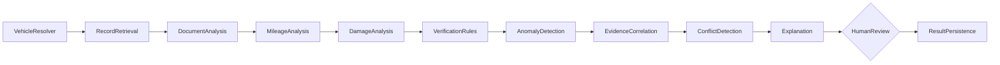

# TrustDrive — Final Completion Report

> §21 deliverable. Actual versions, inventory, coverage, test results, defects
> and blockers. Verified 2026-11-05.

## 1. Technologies actually running

| Layer | Versions |
| --- | --- |
| Frontend | Next.js 14.2.35 (App Router), React 18, TypeScript 5, Tailwind 3.4 |
| 3D / motion | three 0.169, @react-three/fiber 8, @react-three/drei 9, GSAP 3.15 |
| Client state / validation | Zustand 5, Zod 4, Recharts 3 |
| Web backend | Next.js route handlers (102 `route.ts`), `node:sqlite` |
| Backend API | FastAPI, Pydantic v2, SQLAlchemy 2.x, Alembic, Python 3.13 |
| Document AI | PyMuPDF 2.1, OpenCV 5.0 (headless) |
| ML | scikit-learn 1.9.1 (IForest + LOF), XGBoost 3.4.1, ultralytics 8.4.202 (YOLO11m), sentence-transformers 6.2, onnxruntime 1.31.1 |
| OCR | PaddleOCR 3.7.0 (oneDNN disabled), RapidOCR 1.2.3, PyMuPDF, OpenCV |
| Local LLM | torch 2.15+cpu, transformers 5.22, Qwen2.5-0.5B / SmolLM2-360M |
| Agent | langgraph 1.2.20 + MemorySaver checkpointer |
| Runtime | Node 22.22.2, Python 3.13.14 |
| Tests | Vitest 1.6, RTL 16, jsdom 25, Playwright 1.48 (spec), Pytest 8 |

## 2. Database and migration state

- SQLite `.data/trustdrive.db`, `SCHEMA_VERSION = 3`, `PRAGMA user_version = 3`.
- **51 tables**, 30 indexes, 11 immutability triggers, 5 canonical views.
- Seeded: 7 users, 13 vehicles, 80 documents, 35 mileage readings, 25 history
  events, 111 chain records, 8 damage records, 6 inspections, 8 reports.
- Alembic `0001_intelligence_tables` is additive only (no-op on the shipped schema).
- `npm run schema:dump` regenerates `docs/ERD.md`.

## 3. File inventory (summary)

**Web** — `app/` 51 pages + 102 API routes; `components/` 89 components (public,
buyer, seller, admin, shared, ui, theme); `lib/` 23 modules; `types/`; `tests/` 7
Vitest files + component suite; `e2e/` Playwright spec.

**Backend** — `services/intelligence/` 30+ Python modules: config, db,
security, ratelimit, repository, ocr, extract, detectors, explain, llm, agent,
worker, tasks, main; 10 routers (auth, users, vehicles, marketplace, inquiries,
reports, notifications, audit, v1); integrations (vehicle_data, insurance, llm,
storage); intelligence (rules, mileage/xgboost, damage/yolo, scoring,
evaluation, retrieval); Alembic; 7 test modules.

**Delivery** — `Dockerfile`, `services/intelligence/Dockerfile`,
`docker-compose.yml`, `.dockerignore`, `.env.example`,
`.github/workflows/ci.yml`, `scripts/{fetch_models,train_mileage_xgb,next-build-notrace}.py`,
`models/README.md`.

**Docs** — README, ARCHITECTURE, TECH_STACK, IMPLEMENTATION_STATUS,
BUGS_AND_GAPS, IMPLEMENTATION_REPORT, AGENTS, ASSET_REGISTER, and `docs/`:
PROJECT_AUDIT, CURRENT_ARCHITECTURE, TECH_STACK_DECISIONS, FEATURE_GAP_MATRIX,
SYSTEM_ARCHITECTURE, DATABASE_ERD, ERD, ER_DIAGRAM, API_SPECIFICATION,
RBAC_MATRIX, AI_ML_ARCHITECTURE, MODEL_ASSETS, 3D_ASSET_MAPPING, THREAT_MODEL,
DEPLOYMENT, SECURITY, TESTING, TEST_PLAN, BACKEND_COMPLETION_REPORT,
FINAL_COMPLETION_REPORT.

## 4. Feature status

Full per-feature table: `docs/FEATURE_GAP_MATRIX.md`.

| Domain | Complete | Partial | Blocked |
| --- | --- | --- | --- |
| Seller (17 features) | 16 | 1 (document binary upload served by Next; Python registers metadata) | 0 |
| Buyer (10 features) | 10 | 0 | 0 |
| Shared/platform (15) | 13 | 1 (loading/empty states not uniform on secondary lists) | 1 (external registry) + 1 adapter (malware scan inactive unless configured) |
| AI/ML (12 capabilities) | 5 active | 5 adapters inactive without weights/packages | 2 (YOLO weights, XGBoost corpus) |

## 5. API coverage

- **137 OpenAPI paths** in the Python service: 54 `/api/v1`, 68 `/api/backend`,
  13 `/api/intelligence`, 2 root/health.
- **88** Next.js route files under `app/api/v1/*`.
- Contract categories: auth, users, vehicles, documents, history, mileage,
  inspections, damage, verification, investigations, listings, marketplace,
  search, saved, comparisons, inquiries, reports, QR, notifications, audit,
  health. All tested or covered by the security contract test.

## 6. Database entity coverage

All **24** required entities exist; 5 are canonical views over historical tables
(`vehicle_documents`, `vehicle_listings`, `vehicle_history`, `mileage_records`,
`blockchain_records`). See `docs/DATABASE_ERD.md`.

## 7. AI/ML and agent

- Active: PDF text layer, **RapidOCR image OCR**, OpenCV preprocessing,
  deterministic mileage/document rules, Isolation Forest + LOF, **XGBoost
  (synthetic-demo model, not used by findings)**, additive trust score, keyword
  retrieval, LangGraph 15/16-node conditional investigator with checkpointer, **YOLO11m damage
  detection** (MIT weights, six classes) and a **local LLM** (Qwen2.5-0.5B /
  SmolLM2-360M) with four output guardrails.
- **Grounded chat:** `POST /api/intelligence/chat` powers the in-app assistant,
  with four output gates and a deterministic fallback.
- Inactive adapters (honest): **pgvector** only (a vector database); PaddleOCR,
  RapidOCR, sentence-transformers, YOLO11m, XGBoost and the local LLM are active.
- No LLM sets the trust score; offline it returns **no conclusion**.
- Model governance: `scripts/fetch_models.py` requires a licence, records
  SHA-256, caps size; `models/MODEL_REGISTER.json`; research in
  `docs/MODEL_ASSETS.md`; licences in `ASSET_REGISTER.md`.



## 7c. Platform parity (closed)

- **Pagination parity:** notifications accept `?page=&pageSize=` and
  `?limit=&before=`; `unread=1` filters in SQL; audit pages with
  `LIMIT/OFFSET`. Both return a `page` envelope.
- **Soft-delete parity:** additive `deleted_at` on `users`/`documents`;
  `DELETE /api/v1/users/me`, `/documents/:id`, `/admin/users/:id`; login,
  sessions and reads exclude deleted rows; rows are retained for audit.
- **Blockchain:** `app/blockchain/` reports `anchoring_claimed: false`; only the
  local SHA-256 chain is used, and the payload says it is not an on-chain anchor.
- **UI surfaces:** `/technology` shows a live stack panel (OCR, YOLO, XGBoost,
  retrieval, agent, LLM, blockchain) via `/api/v1/ai/stack`; `/seller/documents`
  has a soft-delete action; seller/buyer/admin settings have an account Danger
  Zone; notifications and audit already expose pagination controls.

## 8. 3D asset

`public/models/car.glb` (38,997,992 B, single merged mesh). Real GLB with
GLTFLoader, 360°, zoom, five presets, full-screen, auto-rotate, click-to-select,
WebGL fallback. Hotspots map to `damage_records.zone_id`. Licence **UNCONFIRMED**
— see `ASSET_REGISTER.md`. Exploded view omitted (model has no separated parts).

## 9. Security test results

`tests/test_security.py` — **15 passed**: unauthenticated rejection, buyer→seller
denial, cross-seller edit denial, private-document denial, QR privacy, invalid
magic bytes, oversized upload, invalid SHA-256, SQL-injection login, stored
markup as data, rate-limit 429 + Retry-After, v1 contract coverage.
Rate limiting and signed download URLs are implemented; the scanner is an
adapter inactive unless `TD_MALWARE_SCAN_URL` is set, and the rate-limit bucket
is in-process only.

## 10. Test and build results

| Check | Result |
| --- | --- |
| `npx tsc --noEmit` | ✅ exit 0 |
| `npm test` | ✅ 10 files / 69 tests (incl. RTL) |
| `npm run build` | ✅ exit 0 · BUILD_ID `n2Zi3X7dEmceONjKyy8Vx` · 51 pages |
| `python -m pytest -q` | ✅ **88 passed** |
| `python scripts/eval_llm.py` | ✅ **10/10 passed** (2 LLM narratives, 8 deterministic) |
| `npm run test:e2e` | ⚠️ 21-step spec ready; browsers not installed locally |
| Real-DB smoke | ✅ intelligence + backend (real logins, PDF, QR, audit RBAC) |

## 11. Known defects and blockers

1. Signed/expiring document URLs — implemented (`signed.ts`); rotate the signing secret.
2. Malware scanning — adapter present (`scan.ts`); inactive until `TD_MALWARE_SCAN_URL` is set.
3. Per-IP rate limiting — implemented in-process; a gateway/Redis bucket is required for multi-instance.
4. pgvector (vector database) — optional; in-memory sentence-transformers
   retrieval is active. PaddleOCR, RapidOCR, YOLO11m, XGBoost and the local LLM
   are installed and verified.
5. No real labelled fraud corpus — the XGBoost model is synthetic-demo; retrain
   on real labels before production.
5. Playwright browsers absent locally.
6. GLB/font/image licences unconfirmed (`ASSET_REGISTER.md`).
7. PyMuPDF AGPL/commercial licence must be resolved for closed-source distribution.
8. Loading/empty states not uniform on every secondary list.

## 12. Demo credentials (seeded local only)

Password `demo1234` for: `admin@trustdrive.dev`, `samarth@trustdrive.dev`,
`aditya@trustdrive.dev`, `rohan@trustdrive.dev`, `priya@trustdrive.dev`,
`arjun@trustdrive.dev`.

## 13. Commands

```bash
# Web
npm ci && npm run seed:reset && npm run dev

# Backend
python -m pip install -r services/intelligence/requirements.txt
npm run intel:migrate && npm run intel:serve && npm run intel:worker

# Verify
npx tsc --noEmit
npm test
NEXT_DIST_DIR=.next_verify npm run build
npm run intel:test
npm run test:e2e -- --project=chromium-1920

# Deploy
docker compose up --build
docker compose --profile production up --build
```
