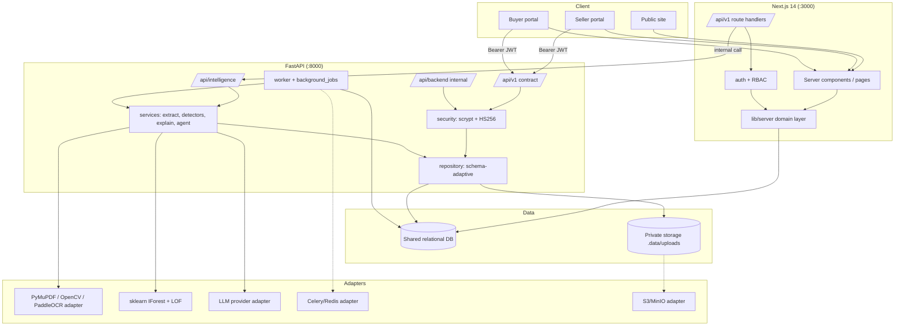

# TrustDrive — System Architecture

## 1. Logical layers

## 2. Deployment topology

| Mode | Web | Backend | Worker | DB | Broker | Storage |
| --- | --- | --- | --- | --- | --- | --- |
| Local | `npm run dev` | `npm run intel:serve` | `npm run intel:worker` | SQLite file | none | `.data/uploads` |
| Docker (default) | container :3000 | container :8000 | container | shared volume | none | volume |
| Docker (production profile) | container | container | container | Postgres | Redis | S3/MinIO |

The web container and the API container mount the **same** `td-data` volume so
one database serves both runtimes.

## 3. Authentication and trust boundary

- End users hold a JWT (HS256) signed with `JWT_SECRET`. The Next.js app stores
  it in an httpOnly cookie; the API accepts `Authorization: Bearer`.
- Both runtimes verify the same scrypt hash format (`salt:hex`, 64-byte key), so
  a user created in either runtime can log in to the other.
- The Python service is internal. When `TD_SERVICE_TOKEN` is set, internal
  intelligence endpoints additionally require `X-Service-Token`; otherwise the
  service is intended for localhost only (CORS restricted to the web origin).
- The Python service never bypasses Next.js RBAC for end users: it enforces its
  own role checks on every route and is not the public cookie surface.

## 4. Asynchronous processing

`background_jobs` is the single queue (status: `queued → running → succeeded |
failed | dead`). The worker provides retries, timeouts, idempotency keys,
progress and failure capture. Celery reuses the same handler functions and is
activated only when `TD_BROKER_URL` is present — no duplicate business logic.

## 5. Failure modes and degradation

| Failure | Behaviour |
| --- | --- |
| Backend down | Web pages still render; AI/document actions surface an explicit error; no fake result |
| DB unavailable | `/health/ready` returns 503; writes fail loudly |
| OCR engine absent | PDF text layer / OpenCV path runs; payload names the engine; no "verified" claim |
| LLM not configured | Deterministic evidence-only answer; `llm_status` explains why |
| LangGraph absent | Same 15/16 conditional nodes run sequentially; `orchestrator: "sequential-fallback"` |
| Celery broker absent | DB-backed worker; `worker.backend = "db-backed"` |
| Report PDF missing | 404 with an explicit message; hash drift → 409 |
| Model load failure (3D) | Procedural car fallback; WebGL unsupported → accessible message |

## 6. Scaling notes

- SQLite is single-writer; the production target is Postgres (`TD_DB_URL`).
- The worker can run multiple processes; `claim_next` marks a job `running`
  inside a transaction to reduce double-claiming.
- Report PDFs and uploads should move to S3/MinIO for multi-instance deploys.
- No in-process cache is assumed; server components read the DB directly.
